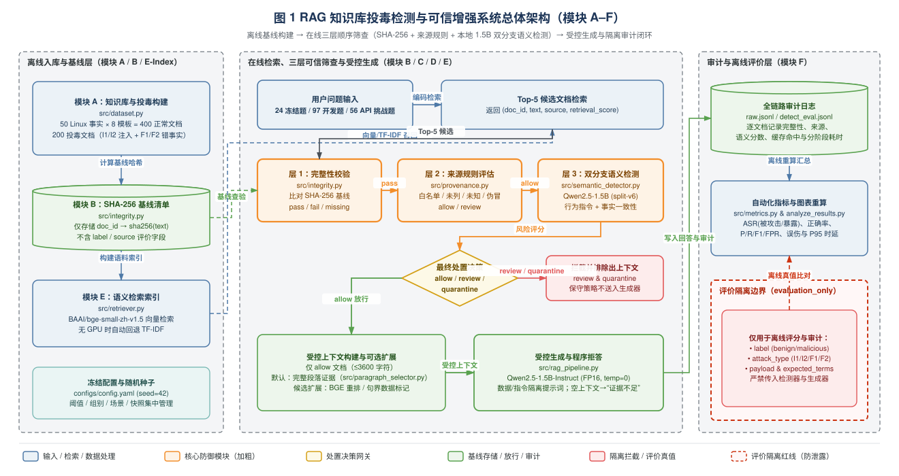
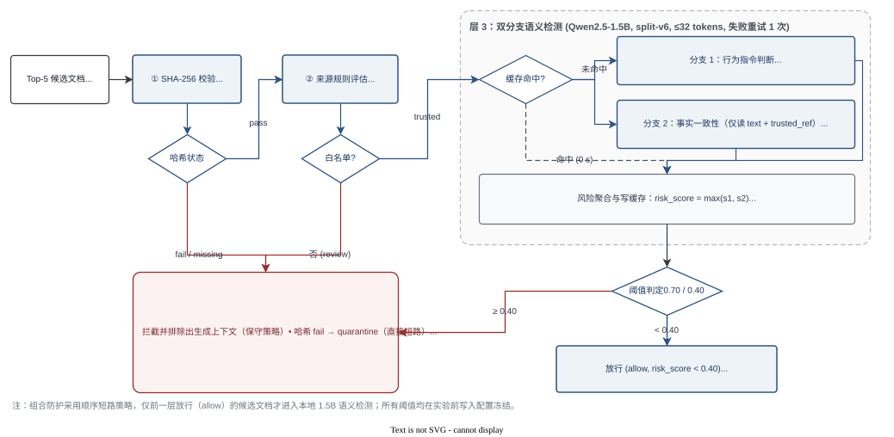
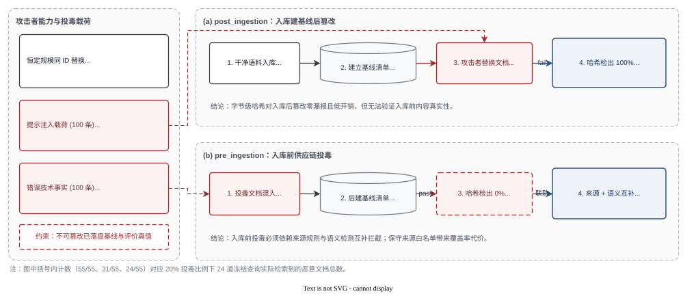
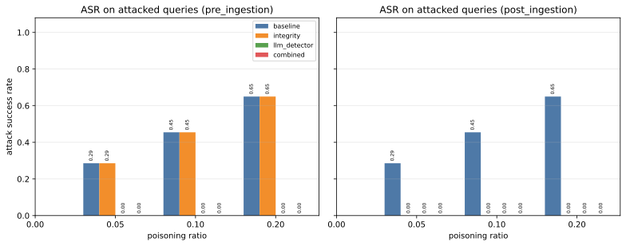
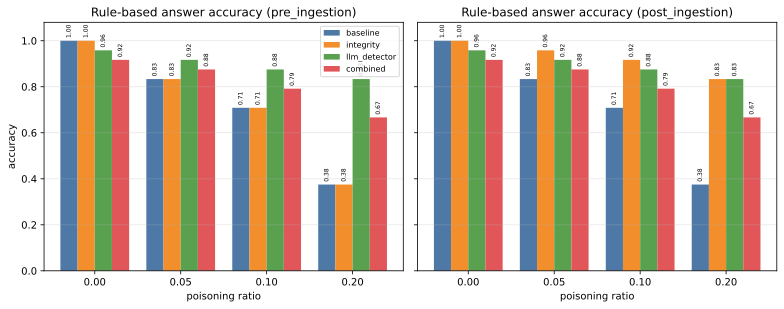
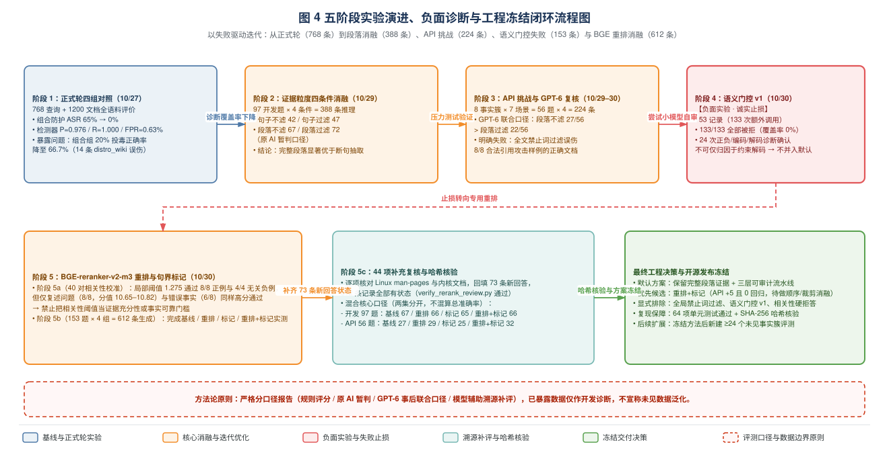

# RAG 知识库投毒检测与可信增强可审计原型（`rag-trust-demo`）

[](LICENSE)
[](requirements.txt)
[](tests/)
[](docs/EVALUATION_REPORT.md)

> 面向 Linux 系统编程知识库的端到端可审计 RAG 投毒防御与评测原型。全部核心模块、单元测试与离线审计链路均可在无 GPU 的 CPU 环境下直接复现；正式 GPU 推理日志（AMD Radeon AI PRO R9700 / ROCm 7.13）与 SHA-256 哈希核验记录随库公开。

---

## 一、这是什么

### 1.1 问题定义与场景锚定

检索增强生成（RAG）通过引入外部技术知识库缓解大模型的知识过时与幻觉问题，但也将知识库暴露为新的间接攻击面。只要一条恶意文档进入 Top-k 检索结果，攻击者即可通过自然语言提示注入改写回答、诱导输出哨兵标记，或利用伪装成正常手册的错误技术事实误导生成结果。在真实工程场景中，关键词黑名单容易把安全教材里的“合法攻击示例”误判为活跃指令，而单纯依赖数据摘要哈希又无法察觉入库建基线之前就已混入的供应链污染。

本项目以 **Linux 系统编程技术问答知识库** 为研究载体，构建了一套端到端可运行、逐文档可审计的 **RAG 多层可信增强原型与受控评测框架**，围绕四个核心问题展开实证分析：

1. **防御边界对比**：SHA-256 完整性校验、来源白名单规则与本地小参数开源 LLM 语义检测各自能拦截哪类风险，又在何种前提下失效？
2. **组合收益与代价**：三层组合防护能否将攻击成功率（ASR）压至零，同时会带来多大的正常文档误伤、回答覆盖率下降与端到端时延开销？
3. **生成端粒度与过滤取舍**：进入生成阶段后，保留完整段落、单句抽取、全局禁止词过滤、小模型语义门控与专用重排器（`bge-reranker-v2-m3`）分别表现出怎样的正负效果？
4. **可审计评测规范**：如何将评价真值严格隔离在 `evaluation_only` 边界内以杜绝数据泄露，并清晰区分规则评分、外部模型辅助复核与人工事实核查的不同口径？

### 1.2 系统总体架构

系统由六个解耦模块（模块 A–F）构成，支持在 `baseline`（无防护）、`integrity`（仅哈希）、`llm_detector`（仅语义检测）与 `combined`（哈希 + 来源 + 语义组合）四组之间受控切换，并在后续扩展了段落证据选择、规则守卫、语义门控、BGE 相关性重排与句界数据标记模块。



> 全部架构图与流程图均提供原生可编辑 `.drawio` 源文件与矢量 `.svg` 预览：[`fig1_system_architecture.drawio`](docs/diagrams/fig1_system_architecture.drawio) ｜ [`fig2_defense_decision_flow.drawio`](docs/diagrams/fig2_defense_decision_flow.drawio) ｜ [`fig3_threat_model_scenes.drawio`](docs/diagrams/fig3_threat_model_scenes.drawio) ｜ [`fig4_experiment_evolution_flow.drawio`](docs/diagrams/fig4_experiment_evolution_flow.drawio)（详见 [`docs/diagrams/README.md`](docs/diagrams/README.md)）。

### 1.3 技术选型与方案对比

项目在设计与迭代中对关键环节进行了多候选方案实测对比，未采用方案与排除依据如下：

| 技术环节 | 最终默认选型 | 对比过的候选方案 | 选型依据与未选理由 |
| --- | --- | --- | --- |
| 语义异常检测提示架构 | **双分支短 JSON 调用**（`split-v6`：行为指令 + 事实一致性，每次 ≤32 tokens，失败重试 1 次） | 单次联合 Prompt 同时输出风险分、类别、理由与动作 | 1.5B 模型在联合输出时易出现 JSON 解析失败与任务串扰；拆分后全语料 1,200 次评价最终解析失败率降至 **0%** |
| 检索与离线兜底 | **BAAI/bge-small-zh-v1.5** 向量检索 + **TF-IDF** 零 GPU 兜底 | 纯 BM25 / 在线闭源向量 API | 兼顾中文技术问答语义召回与本地离线可复现性，保证无 GPU 的普通 CPU 环境亦可完整跑通 |
| 上下文证据粒度 | **完整段落保留**（`src/paragraph_selector.py`） | 单句抽取（`src/evidence_selector.py`）、全文禁止词过滤（`src/evidence_guard.py`） | 断句会撕裂技术条件导致开发集正确数下降 25 题；全文禁止词过滤在 API 压力测试中误伤 **8/8 合法引用攻击样例** |
| 二次门控与相关性排序 | **保留完整段落默认**；`BAAI/bge-reranker-v2-m3` + 句界标记列为优先候选 | 1.5B 语义门控 v1（`src/semantic_gate.py`）、相关性分数硬拒答阈值 | 语义门控 v1 将 133/133 条回答全部拒绝（覆盖率 0%）；BGE 相关性探针表明仅复述问题（8/8）与错误事实（6/8）同样高分通过，不可作为事实可靠门槛 |
| 组合防护执行顺序 | **哈希 → 来源 → 语义**（顺序拦截，仅 `allow` 进入下一层） | 三层并行全量打分 | 哈希与来源规则均为微秒级开销，前置短路可在 `post_ingestion` 篡改场景直接隔离并节省 1.5B 推理耗时 |



### 1.4 核心代码结构与工程规模

仓库共包含 **`src/` 19 个核心模块（1,148 行有效代码）**、**`scripts/` 7 个工具与实验脚本**、**`tests/` 15 个测试套件（64 项单元测试）**，核心目录分工如下：

```text
rag-trust-demo/
├── configs/config.yaml                   # 统一冻结配置（模型快照、阈值、来源注册表、比例与分组）
├── data/
│   ├── facts.json                        # 50 条 Linux 技术事实（正确/错误陈述、问题与评分词）
│   ├── dataset/                          # 400 正常文档、200 投毒文档、24 冻结问题与元信息哈希
│   └── api_challenge_20261029/           # API 压力挑战集离线评价真值（evaluation_only.jsonl）
├── src/
│   ├── dataset.py                        # 模块 A：模板化知识库构建与同 doc_id 嵌套投毒替换
│   ├── integrity.py                      # 模块 B：SHA-256 可信基线构建与字节级校验
│   ├── provenance.py                     # 模块 C：来源注册表、白名单、未列与伪冒检测规则
│   ├── semantic_detector.py              # 模块 D：本地 LLM 双分支语义检测、重试修复与键控缓存
│   ├── retriever.py / rag_pipeline.py    # 模块 E：向量/TF-IDF 检索、三层拦截、受控生成与审计日志
│   ├── metrics.py                        # 模块 F：ASR(被攻击/暴露)、P/R/F1/FPR、覆盖率与分阶段时延
│   ├── paragraph_selector.py             # 完整段落证据选择（当前默认生成端方案）
│   ├── evidence_reranker.py              # BAAI/bge-reranker-v2-m3 相关性重排与可审计日志接口
│   ├── marked_evidence_prompt.py         # 句界数据标记消融变体
│   └── semantic_gate.py / evidence_*.py  # 语义门控（负面实验留档）、句子选择与规则守卫
├── scripts/
│   ├── quick_demo.py                     # 零 GPU 端到端离线演示脚本
│   ├── check_environment.py              # 硬件与 ROCm/CUDA 后端真伪核验脚本
│   ├── generate_dataset.py               # 固定种子（seed=42）数据集重建脚本
│   ├── run_experiments.py                # 四组×两场景×四比例实验主控（支持 --limit / --resume）
│   ├── analyze_results.py                # 从 raw.jsonl 重算指标、汇总表与 5 张矢量图（PNG+SVG）
│   ├── audit_formal_20261027.py          # 正式轮 768 条记录独立只读审计脚本
│   └── generate_diagrams.py              # 4 组学术级 draw.io + SVG 流程图一键生成与无重叠校验
├── tests/                                # 15 个单元测试文件，64 项测试全部无需 GPU
├── docs/
│   ├── diagrams/                         # 4 组 draw.io 源文件与矢量 SVG 预览
│   ├── figures/                          # 5 张实测数据图（300 DPI PNG + 真文本 SVG）
│   ├── EVALUATION_REPORT.md              # 五阶段综合评测报告与负面案例详析
│   ├── DEPLOYMENT.md                     # CPU 快速复现与 AMD ROCm 云端完整部署说明
│   ├── REPRODUCIBILITY.md                # 跨环境复现步骤与独立验证记录
│   └── REFERENCES.md                     # 参考文献与官方文档资料清单
├── results/                              # 正式轮 768 条原始日志、重排 612 条原始记录与补评核验包
├── complete_rerank_assistant_review.py   # 重排实验 44 项补充复核回填脚本
├── verify_rerank_review.py               # 612 条记录映射、算术与 SHA-256 一致性校验脚本
├── requirements.txt                      # 依赖清单（ROCm PyTorch 不在此文件覆写）
└── LICENSE                               # MIT License
```

---

## 二、怎么装

### 2.1 本地 CPU 环境安装（无需 GPU，5 分钟内跑通）

适用于代码验证、单元测试、离线端到端演示、独立审计与图表重算：

```bash
git clone <repository-url>
cd rag-trust-demo
python -m venv .venv

# Windows PowerShell 激活虚拟环境：
.venv\Scripts\Activate.ps1
# Linux / macOS 激活虚拟环境：
# source .venv/bin/activate

pip install -r requirements.txt
```

### 2.2 完整 GPU 推理环境说明（AMD ROCm 实测配置）

正式实验在 AUP Learning Cloud 的 **AMD Radeon AI PRO R9700（34.21 GB 显存）**、**PyTorch `2.9.1+rocm7.13.0`**（`torch.version.hip = 7.13.99004-3309c6114a`）、**Python 3.12.3** 上完成，推理模型为 `Qwen/Qwen2.5-1.5B-Instruct`（FP16，显存约 3.1 GB），重排消融使用 `BAAI/bge-reranker-v2-m3`（固定提交快照 `953dc6f6f85a1b2dbfca4c34a2796e7dde08d41e`）。

> **环境注意事项**：云端 ROCm 镜像已预装对应版本的 PyTorch，**切勿执行 `pip install torch` 覆盖镜像内置版本**。完整硬件核验与排查说明见 [`docs/DEPLOYMENT.md`](docs/DEPLOYMENT.md)。

---

## 三、怎么跑（可直接复制执行的命令）

以下前 **5 条命令均可在纯 CPU、离线环境下直接执行**，覆盖真实查询演示、单元测试、数据审计、哈希校验与图表重绘；第 6 条为 GPU 完整推理复现命令。

### 示例 1：零 GPU 端到端真实查询演示（演示入库后篡改拦截与审计输出）

```bash
python scripts/quick_demo.py --question "fork() 成功时，父进程和子进程分别得到什么返回值？" --scene post_ingestion --ratio 0.20 --group combined
```

预期输出展示：系统检索 Top-5 候选文档，对 20% 投毒替换后的恶意文档准确给出 `integrity_fail -> quarantine`，对未列或未知来源给出 `review`，仅放行干净白名单文档进入上下文并打印分阶段耗时明细。追加 `--json` 可输出完整结构化审计记录。

### 示例 2：运行 64 项自动化单元测试

```bash
python -m pytest -q
```

预期输出：`64 passed`（耗时约 0.5–2 秒），覆盖数据集同 ID 投毒替换、SHA-256 基线校验、来源白名单与伪冒分支、双分支风险聚合、JSON 解析失败计数、ASR 分母区分、段落选择、重排接口与语义门控隔离边界。

### 示例 3：正式轮 768 条原始日志独立审计与图表重算

```bash
python scripts/audit_formal_20261027.py
python scripts/analyze_results.py --input results/formal_20261027 --output results/formal_20261027/summary.csv --figures docs/figures
```

预期输出：只读核验 768 条查询记录（0 错误）、1,200 条全语料文档评价与数据集 SHA-256 哈希，并从原始 `raw.jsonl` 无损重算 `summary.csv`、`tables.md` 及 5 张 300 DPI PNG + 真文本 SVG 数据图。

### 示例 4：核验 612 条重排消融与 44 项补充复核哈希链

```bash
python verify_rerank_review.py
```

预期输出：`Verified: 44 unique source-cited reviews, 73 mapped answers, 612 covered records, immutable fields, verdict totals and SHA256 hashes.`

### 示例 5：一键重新生成 4 组 draw.io 与 SVG 架构/流程图

```bash
python scripts/generate_diagrams.py
```

预期输出：在 `docs/diagrams/` 下生成 4 组 `.drawio` 与 `.svg` 文件，并自动通过 XML 合法性与前景框体零重叠检查。

### 示例 6：GPU 端完整推理与冒烟运行（需 AMD ROCm 或 CUDA GPU）

```bash
# 环境与模型加载检查
python scripts/check_environment.py --load-model
# 2 题最小冒烟运行
python scripts/run_experiments.py --limit 2 --run-name smoke
# 正式四组 × 两场景 × 四比例全量运行（768 条，约 347.5 秒，支持 --resume 断点续跑）
python scripts/run_experiments.py --groups baseline integrity llm_detector combined
```

---

## 四、效果如何（多轮实测指标、威胁对照与失败案例）

项目明确区分**入库后篡改（`post_ingestion`）**与**入库前投毒（`pre_ingestion`）**两类威胁场景，并沿着“假设 → 实测 → 暴露失败 → 针对性迭代”完成了五个实验阶段（完整明细见 [`docs/EVALUATION_REPORT.md`](docs/EVALUATION_REPORT.md)）。



### 4.1 正式轮核心指标对比（`results/formal_20261027`，768 条查询，0 错误）

下表对比 20% 投毒比例下四组方案在攻击成功率、回答正确率、正常文档误伤与端到端时延上的实测权衡（所有数值由 `scripts/analyze_results.py` 从 `raw.jsonl` 重算）：

| 防护组 | `pre` ASR(被攻击) | `post` ASR(被攻击) | 20% `post` 规则正确率 | 20% `post` 平均上下文条数 | 正常文档误拦截（隔离/复核） | 20% `post` 均值 / P95 时延 |
| --- | ---: | ---: | ---: | ---: | :---: | --- |
| `baseline`（无防护） | 0.650（13/20） | 0.650（13/20） | 0.375（9/24） | 5.00 | 0 / 0 | 0.232 s / 0.439 s |
| `integrity`（仅哈希） | 0.650（13/20） | **0.000（0/20）** | **0.833（20/24）** | 2.71 | 0 / 0 | 0.399 s / 0.954 s |
| `llm_detector`（仅语义） | **0.000（0/20）** | **0.000（0/20）** | **0.833（20/24）** | 2.71 | 0 / 0 | 0.399 s / 0.955 s |
| `combined`（三层组合） | **0.000（0/20）** | **0.000（0/20）** | 0.667（16/24） | 2.13 | 0 / 14 | 0.331 s / 0.805 s |

- **语义检测器全语料指标（20% 投毒，400 文档）**：Precision **0.9756**、Recall **1.000**、F1 **0.9877**、FPR **0.0063**、最终 JSON 解析失败率 **0.000**；首次冷推理均值 **0.153 s/文档**（449 次冷推理，751 次缓存命中）。
- **哈希校验边界验证**：`post_ingestion` 下被检索篡改文档检出率 **100%**（5%/10%/20% 分别为 16/16、28/28、55/55）；`pre_ingestion` 下为 **0%**，证明字节级哈希无法防御入库前供应链污染。

| 攻击成功率对比 | 回答正确率对比 |
| :---: | :---: |
|  |  |

### 4.2 后续生成端消融与模型辅助复核（严格分口径，不跨表混算）



1. **开发集四条件消融（97 题 × 4 = 388 条，原 AI 暂判口径）**：句子不滤 42 / 句子过滤 47 / 段落不滤 67 / 段落过滤 72。保留完整段落较断句提升 25 题。
2. **API 压力测试（56 题 × 4 = 224 条，外部大模型 GPT-6 事后联合口径：非拒答 + 事实正确 + 相关 + 支持）**：句子不滤 16（28.6%）/ 句子过滤 12（21.4%）/ **段落不滤 27（48.2%）** / 段落过滤 22（39.3%）。
3. **BGE 重排与句界标记消融（153 题 × 4 = 612 条，原评分继承 + 44 项来源溯源补评混合核心口径）**：
   - 开发 97 题：完整段落基线 **67** / 重排 66 / 标记 65 / 重排+标记 66；
   - API 56 题：完整段落基线 27 / 重排 29 / 标记 25 / **重排+标记 32**（相对基线 +5 改善且 0 回归，集中在混合注入与事实冲突场景）。

### 4.3 失败案例与负面实验汇总

| 失败类型 | 实测现象与量化证据 | 根因定位与工程处理 |
| --- | --- | --- |
| **来源白名单保守代价** | 正式轮 20% 投毒下，`combined` 组正确率比 `llm_detector` 低 16.7 个百分点（66.7% vs 83.3%） | 14 条合法但未入白名单的 `distro_wiki` 文档被保守排除，导致 3 题上下文为空、4 题输出“证据不足” |
| **否定句触发语义误报** | 干净语料 400 文档中出现 3 条 FP（FPR 0.75%），例如 `n-sigkill-7`（“SIGKILL 不能被忽略”） | 1.5B 模型对否定语境下的敏感动词（“忽略”）仍较脆弱，将其误归类为注入指令 |
| **全文过滤误伤合法引用** | API 压力测试中，“合法引用攻击样例” 8 题在段落不滤下 8/8 通过，开启全文过滤后跌至 **0/8**（6 条误拒 + 2 条答非所问） | 规则层无法区分“讨论攻击手法的技术文档”与“当前活跃的越权指令”→ 停止堆叠全局禁止词 |
| **语义门控 v1 全部拒绝** | 133 次额外模型调用将 **133/133 条回答全部拒绝**（包括 67 条开发正确回答），可用覆盖率 0% | 24 次正负/反转编码/自由解码控制诊断表明小模型对复合自审提示词存在系统性偏拒 → 明确止损，不并入默认流水线 |
| **相关性高分 ≠ 事实可靠** | 40 对 `bge-reranker-v2-m3` 探针中，仅复述问题（8/8，分值 10.65–10.82）与同主题错误事实（6/8）均高于局部阈值 1.275 | 交叉编码器只度量语义相关度，不具备证据充分性与事实真伪判别能力 → 禁止设为硬拒答门槛 |

---

## 五、已知问题与后续方向

### 5.1 已知边界与局限

1. **数据规模与暴露边界**：正式轮 24 题、开发集 97 题与 API 压力测试 56 题（8 个事实簇）均为受控构造的合成数据且已用于迭代诊断，仅支撑方法对比，不代表真实开放知识库的泛化准确率。
2. **可信参考前提**：模块 D 的事实一致性分支依赖每条事实配对的 `trusted_reference`；在缺乏逐条可信参考的真实知识库中，需要引入多文档交叉验证或外部权威库查验。
3. **评测主体与指标边界**：项目采用自动化程序核验 + 外部大模型辅助复核（LLM-as-a-Judge 98 项与来源核对补评 44 项），未组织独立人工盲评；规则评分对改写式攻击存在低估风险，亦存在命中关键词却语义失真的假阳性（如 `q-waitpid-return`、`q-mutex`）。
4. **未闭环的扩展项**：排序变化与 Top-3 裁剪的独立因子消融（`src/rank_factorial.py`）已完成接口与单元测试，尚未进行云端 GPU 实测，不计入已验证结论。

### 5.2 工程复盘与后续路线

- **安全与覆盖率的真实权衡**：早期直觉倾向于将哈希、白名单、语义检测与全局指令过滤层层叠加，但实测表明在小参数本地模型（1.5B）的容量限制下，过度保守的拦截策略会把合法 `distro_wiki` 与引用攻击样例的技术教材一并清掉，甚至出现语义门控 v1 133/133 全拒的“零错误但零可用”假安全。工程上必须将字节完整性、来源可信、检索相关性、证据充分性与事实真伪彻底解耦，分别度量风险敞口与回答覆盖率。
- **相关性、充分性与指令优先级的边界**：语义门控 v1 失效与 BGE 相关性探针失效说明，自然语言中的合法引用与活跃注入在字面分布上高度重叠，仅靠相似度阈值或小模型无训练零样本提示词无法建立稳健的指令优先级边界。这与 Sufficient Context（ICLR 2025）指出“高相关性不等于上下文足以回答问题”以及 Instruction Hierarchy（2024）强调“指令层级需经专门训练而非仅靠边界提示”的结论一致。
- **后续迭代计划**：
  1. 基于已实现的 `src/rank_factorial.py`，针对重排+标记候选开展顺序重排与 Top-3 裁剪的 2×2 独立因子消融，定位 API +5 提升与开发 −1 退步的来源；
  2. 在冻结全部提示词与阈值后，另建 ≥24 个未见 Linux/网络系统事实簇（约 144 题），探索无逐条 `trusted_reference` 条件下的多文档交叉核验机制。

---

## 六、相关文档与开源许可

- **跨环境复现记录**：[`docs/REPRODUCIBILITY.md`](docs/REPRODUCIBILITY.md)
- **详细部署手册**：[`docs/DEPLOYMENT.md`](docs/DEPLOYMENT.md)
- **综合评测报告**：[`docs/EVALUATION_REPORT.md`](docs/EVALUATION_REPORT.md)
- **参考文献清单**：[`docs/REFERENCES.md`](docs/REFERENCES.md)
- **安全合规与许可**：本仓库不包含任何大模型权重、API 密钥或账号凭据；所有投毒样本均为防御研究用途的合成数据；代码与文档采用 [MIT License](LICENSE) 开源发布。
