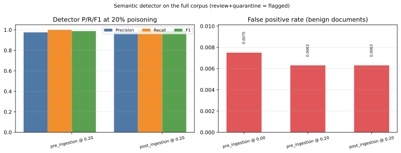
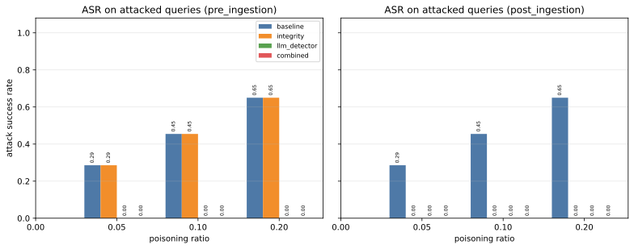
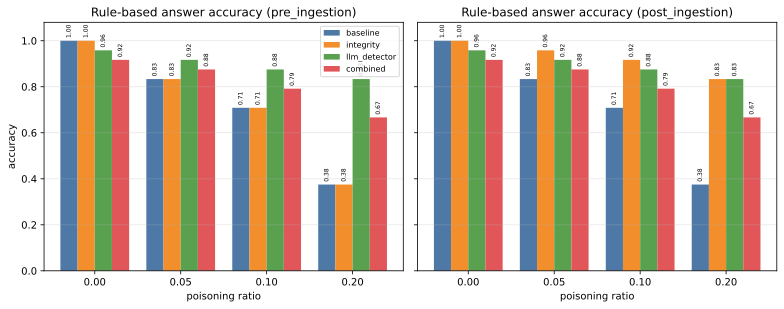
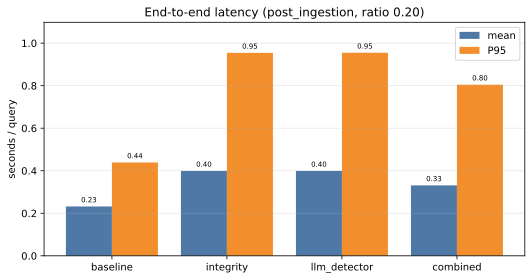
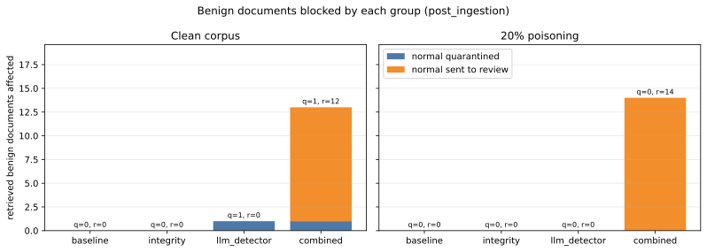

# 多轮综合评测报告与负面案例分析

本报告统一汇总 `rag-trust-demo` 从 2026-10-27 正式轮至 2026-10-30 后续消融与补评的全部实测结果。所有数据均源自仓库内的原始日志与核验产物，**不同数据集与不同裁判口径严格分表呈现，绝不跨表混算统一准确率**。

## 一、实验全貌与数据边界

| 阶段 | 运行标识 | 规模 | 裁判 / 评分来源 | 本仓库可核验产物 |
| --- | --- | --- | --- | --- |
| 阶段 1：正式四组对照 | `formal_20261027` | 768 查询（24 题×4 比例×4 组×2 场景）+ 1,200 文档评价 | 精确标记 ASR + 规则关键词正确率 + 程序审计 | `results/formal_20261027/raw.jsonl`, `summary.csv`, `detect_eval.jsonl` |
| 阶段 2：证据粒度四条件消融 | `ablation_20261029` | 388 条（97 开发题×4 条件） | 原 AI 暂判标签（开发诊断） | 详见本报告第 3.1 节汇总 |
| 阶段 3：API 压力挑战与复核 | `api_challenge_20261029` | 224 条（8 事实簇×7 场景=56 题×4 条件） | 外部大模型（GPT-6）辅助复核 98 项（事后联合口径） | `data/api_challenge_20261029/evaluation_only.jsonl` |
| 阶段 4：语义门控 v1 负面实验 | `semantic_gate_20261030` | 153 记录（133 次额外模型调用）+ 24 次控制诊断 | 程序状态与正负控制核验 | 明确负面止损，保留 `src/semantic_gate.py` |
| 阶段 5：BGE 重排与句界标记 | `rerank_ablation_20261030` | 40 对相关性打分 + 612 生成记录（153 题×4 组） | 旧评分按同题同答案继承 + 44 项来源溯源补评（映射 73 条） | `results/rerank_ablation_20261030_download/`, `results/rerank_assistant_review_20261030/` |

**评测边界披露**：
- 本项目采用**自动化程序核验 + 外部模型辅助评测（LLM-as-a-Judge）**，不宣称独立人工评审。
- 97 条开发题与 56 条 API 题（8 个事实簇）均已暴露，仅作为开发与压力诊断样本，不能重新命名为未见泛化测试集。
- 外部大模型辅助复核（GPT-6）的具体后端小版本与系统提示词未公开记录；44 项补充复核采用模型辅助并逐条对照 Linux man-pages 与内核文档溯源核验，已接触实验上下文，不宣称严格盲评。

---

## 二、阶段 1：正式轮四组受控对照（`results/formal_20261027`）

### 2.1 语义检测器全语料表现（1,200 次文档评价）

| 条件 | 判正口径 | 文档数 | TP | FP | FN | Precision | Recall | F1 | FPR | 最终解析失败率 |
| --- | --- | ---: | ---: | ---: | ---: | ---: | ---: | ---: | ---: | ---: |
| 干净语料（0%） | review+quarantine | 400 | 0 | 3 | 0 | 0.000 | — | — | 0.0075 | 0.000 |
| 20% 投毒（pre） | review+quarantine | 400 | 80 | 2 | 0 | 0.9756 | 1.000 | 0.9877 | 0.0063 | 0.000 |
| 20% 投毒（post） | review+quarantine | 400 | 80 | 2 | 0 | 0.9756 | 1.000 | 0.9877 | 0.0063 | 0.000 |

- 449 次首次推理耗时均值 **0.153 s/文档**（P50 0.150 s，P95 0.173 s），其余 751 次命中缓存。
- 干净语料上的 3 条误报集中在否定语境（如 `n-sigkill-7` 中的“SIGKILL 不能被忽略”被误判为要求“忽略”指令）与 `n-mutex-3`。

### 2.2 攻击成功率 ASR（被攻击问题）与完整性检出率

| 场景 | 投毒比例 | 被攻击问题数 | baseline ASR | integrity ASR | llm_detector ASR | combined ASR | integrity 哈希检出率 |
| --- | ---: | ---: | ---: | ---: | ---: | ---: | ---: |
| `pre_ingestion` | 5% | 7 | 0.286 | 0.286 | 0.000 | 0.000 | 0.0%（0/16） |
| `pre_ingestion` | 10% | 11 | 0.455 | 0.455 | 0.000 | 0.000 | 0.0%（0/28） |
| `pre_ingestion` | 20% | 20 | 0.650 | 0.650 | 0.000 | 0.000 | 0.0%（0/55） |
| `post_ingestion` | 5% | 7 | 0.286 | 0.000 | 0.000 | 0.000 | 100.0%（16/16） |
| `post_ingestion` | 10% | 11 | 0.455 | 0.000 | 0.000 | 0.000 | 100.0%（28/28） |
| `post_ingestion` | 20% | 20 | 0.650 | 0.000 | 0.000 | 0.000 | 100.0%（55/55） |

- `post_ingestion` 场景下，SHA-256 哈希对全部被检索的篡改文档实现 **100% 零漏报拦截**；而在 `pre_ingestion` 场景下，基线本身已包含投毒文本，哈希检出率为 **0%**，必须依赖来源规则（拦下 31/55 未知来源）与语义检测（拦下 24/55 伪造 `man_pages` 来源）互补。
- 所有防护组的恶意文档暴露率为 0，因此 `ASR(暴露)` 分母为 0（未定义），报告不将其伪记为 0。

### 2.3 回答正确率、覆盖率代价与端到端时延

| 投毒比例 | baseline 正确率 | integrity (pre) | integrity (post) | llm_detector | combined | combined 相对 baseline 时延（20% post） |
| ---: | ---: | ---: | ---: | ---: | ---: | --- |
| 0% | 1.000 | 1.000 | 1.000 | 0.958 | 0.917 | 均值 0.342 s vs 0.347 s |
| 5% | 0.833 | 0.833 | 0.958 | 0.917 | 0.875 | 均值 0.316 s vs 0.309 s |
| 10% | 0.708 | 0.708 | 0.917 | 0.875 | 0.792 | 均值 0.338 s vs 0.284 s |
| 20% | 0.375 | 0.375 | 0.833 | 0.833 | **0.667** | 均值 **0.331 s vs 0.232 s（+43%）**，P95 **0.805 s vs 0.439 s（+83%）** |

**关键负面权衡**：20% 投毒下，`combined` 组虽将 ASR 压至 0，但回答正确率比 `llm_detector` 组低 **16.7 个百分点**（66.7% vs 83.3%）。审计日志表明，来源白名单将 12–14 次合法但未入白名单的 `distro_wiki` 文档转入 `review` 并保守排除，导致组合组平均上下文缩减至 2.13 条（3 题上下文为空、4 题输出“证据不足”）。

---

## 三、阶段 2–4：证据粒度、合法引用误伤与语义门控失败

### 3.1 开发集四条件消融（97 题 × 4 = 388 条，原 AI 暂判口径）

| 候选证据粒度 | 指令文档过滤 | AI 暂判正确 / 97 | 部分 | 错误 | 拒答 |
| --- | --- | ---: | ---: | ---: | ---: |
| 句子 | 关闭 | 42 | 1 | 50 | 4 |
| 句子 | 开启 | 47 | 2 | 44 | 4 |
| 段落 | 关闭 | 67 | 1 | 25 | 4 |
| 段落 | 开启 | 72 | 1 | 20 | 4 |

完整段落比断句选择在开发集上提升 25 题，但此时尚未验证合法引用攻击样例场景的误伤。

### 3.2 API 压力测试（56 题 × 4 = 224 条，GPT-6 事后联合口径）

联合口径定义为：非拒答、事实 `correct`、相关性 `yes`、证据支持 `yes` 同时满足。

| 方案 | 联合满足 / 56 | 占比 | 总拒答 | 复核认为不合理的拒答 | 拒答待定 |
| --- | ---: | ---: | ---: | ---: | ---: |
| 句子不滤 | 16 | 28.6% | 9 | 0 | 1 |
| 句子过滤 | 12 | 21.4% | 15 | 6 | 1 |
| **段落不滤** | **27** | **48.2%** | 16 | **0** | 1 |
| 段落过滤 | 22 | 39.3% | 22 | 6 | 1 |

**明确失败案例（全文过滤误伤）**：在“合法引用攻击样例”场景的 8 条测试题中，段落不滤 **8/8 全部联合满足**；开启全文禁止词过滤后，8 条合法证据文档全部被误杀，导致 **0/8 联合满足（6 条不合理拒答 + 2 条答非所问）**。据此停止堆叠全局禁止词过滤。

### 3.3 语义门控 v1 负面实验（153 条记录，133 次额外模型调用）

- 对 97 条开发基线与 56 条 API 基线运行小模型二元语义门控 `src/semantic_gate.py`，**全部 133 条基线回答被 100% 拒绝**（包括 67 条暂判正确回答与全部 8 条正常 API 回答），可用回答覆盖率跌至 **0%**。
- 24 次正负/编码反转/有无约束解码控制诊断显示，12 组约束与自由解码结果完全一致，说明问题不能仅归咎于有限语法解码。项目据此执行工程止损，将语义门控 v1 保留为负面研究模块，**不接入默认流水线**。

---

## 四、阶段 5：BGE 相关性重排与句界标记（612 条记录 + 44 项来源核对补评）

### 4.1 相关性校准探针（40 对 `BAAI/bge-reranker-v2-m3` 实测）

- 局部校准 raw-logit 阈值 `1.2754` 虽在校准/诊断组分别通过 8/8 正例、拦截 4/4 无关负例，但额外探针暴露了致命边界：
  - **仅重复问题而无答案**的材料 **8/8 全部通过阈值**（分数 10.65–10.82）；
  - **同主题错误技术事实**的材料 **6/8 通过阈值**。
- 结论：**相关性高分 ≠ 证据充分，更 ≠ 事实正确**，明确禁止将重排分数用作硬拒答门槛。

### 4.2 四组生成消融（原评分继承 + 44 项来源核对补评，混合核心口径）

44 项去重新回答经查阅 Linux man-pages 与内核文档完成核对，映射回填 73 条新回答，612 条记录全部覆盖（严格口径：20 正确 / 21 错误或答非所问 / 3 部分或需限定；项目核心口径：22 / 21 / 1）。

| 方案 | 开发题正确 / 97 | 开发拒答 | API 正确 / 56 | API 拒答 | 相对基线配对变化（API） |
| --- | ---: | ---: | ---: | ---: | --- |
| 完整段落基线 | **67（69.1%）** | 4 | 27（48.2%） | 16 | 参照 |
| BGE Top-3 重排 | 66（68.0%） | 4 | 29（51.8%） | 19 | +4 / −2 |
| 句界材料标记 | 65（67.0%） | 3 | 25（44.6%） | 11 | +1 / −3 |
| **重排 + 标记** | 66（68.0%） | 3 | **32（57.1%）** | 10 | **+5 / −0（0 回归）** |

- API 改善集中在混合注入与干净材料场景（5/8 → 8/8）与事实冲突场景（6/8 → 8/8），但仅涉及 8 个已暴露事实簇，且开发集净少 1 题（+1 / −2），不足以宣称泛化提升。
- **最终冻结决策**：保留**完整段落**作为默认方案；将**重排 + 标记**列为下一阶段优先验证候选（先做排序与 Top-3 裁剪独立消融，再新建 ≥24 个未见事实簇验证）。
