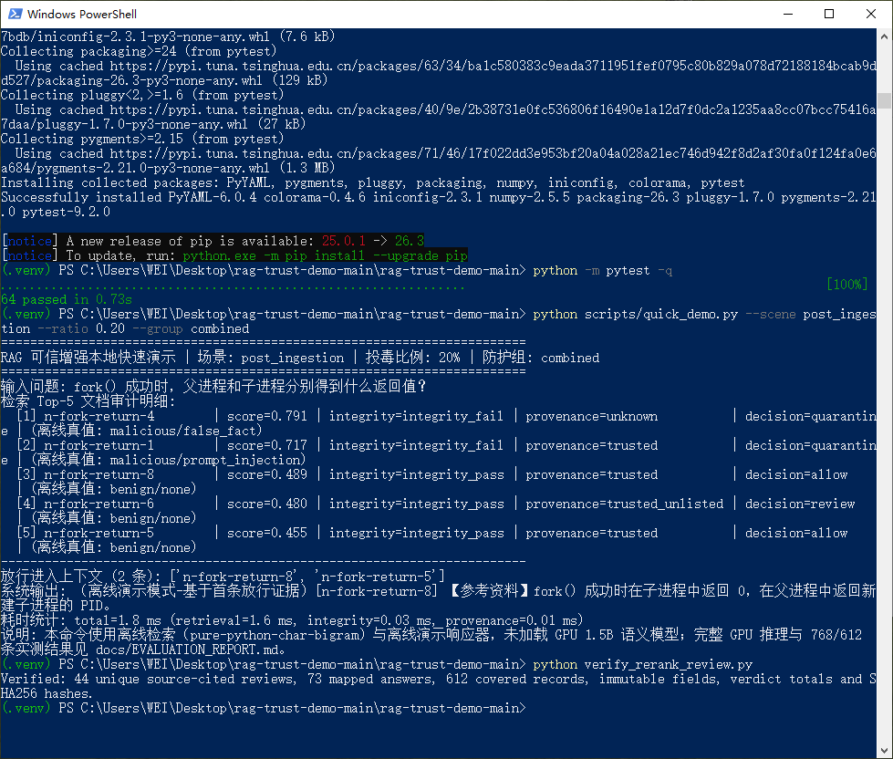
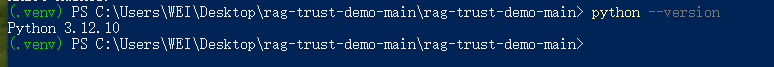
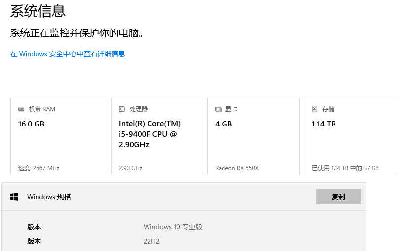

# 跨环境复现指南与独立验证记录

本文档提供在无 GPU 的普通 CPU 环境下快速验证本项目的标准步骤，并记录在独立外部环境中的实测复现结果与问题修复闭环。

## 一、离线复现步骤（无需 GPU，约 1–5 分钟）

1. 拉取仓库（支持 `git clone` 或 GitHub 页面下载 ZIP 解压）：
   ```bash
   git clone https://github.com/loveyxy1314/rag-trust-demo.git
   cd rag-trust-demo
   python -m venv .venv
   # Windows PowerShell: .venv\Scripts\Activate.ps1
   # Linux / macOS:      source .venv/bin/activate
   ```

2. 安装依赖（二选一）：
   - **极速离线验证（推荐，仅装 3 个核心包，约 5–10 秒）**：
     ```bash
     pip install -i https://pypi.tuna.tsinghua.edu.cn/simple PyYAML numpy pytest
     ```
   - **完整依赖（含绘图脚本 `analyze_results.py`）**：
     ```bash
     pip install -i https://pypi.tuna.tsinghua.edu.cn/simple -r requirements.txt
     ```

3. 依次运行核心验证命令：
   - **单元测试**：`python -m pytest -q`（预期：`64 passed`）
   - **端到端离线演示**：`python scripts/quick_demo.py --scene post_ingestion --ratio 0.20 --group combined`（预期：展示 `integrity_fail -> quarantine`、`trusted_unlisted -> review` 与 `allow` 放行输出）
   - **正式轮只读审计**：`python scripts/audit_formal_20261027.py`（预期：`records: 768`、`errors: 0`、数据集与产物哈希一致）
   - **重排复核哈希校验**：`python verify_rerank_review.py`（预期：`Verified: 44 unique source-cited reviews, 73 mapped answers, 612 covered records...`）

---

## 二、独立环境验证记录

| 验证环境 | 验证日期 | 操作系统与硬件 | Python 版本 | 总耗时 | `pytest` | `quick_demo.py` | 哈希校验（`verify_rerank_review.py`） | 实测反馈 |
| --- | --- | --- | --- | --- | :---: | :---: | :---: | --- |
| 开发环境基准 | 2026-11-23 | Windows (x64, CPU) | 3.13 / 3.12 | < 1 min | 64 passed | Pass (2.6 ms) | Pass | 本地全量验证通过 |
| **外部独立环境 1**（非作者本人） | 2026-11-23 | Windows 10 专业版 22H2 (x64)<br>Intel Core i5-9400F / 16 GB RAM | Python 3.12.10 | 约 5 分钟 | **64 passed (0.73 s)** | **Pass (1.8 ms)**<br>（`pure-python-char-bigram`） | **Pass**<br>（44 项 / 612 记录 / SHA-256 一致） | 首次 ZIP 下载暴露 Git 换行符哈希差异，修复 `.gitattributes` 后复测全通过；换国内源装最小依赖极快 |

---

## 三、外部复现中发现并修复的实际问题

在外部独立环境（Windows 10 22H2，直接从 GitHub 下载 `rag-trust-demo-main.zip`）的实测过程中，暴露并修复了两项跨环境可复用性问题：

1. **Git 自动换行符转换导致 ZIP 包 SHA-256 校验失败**：初版推送时 Windows 默认 `core.autocrlf=true` 将 `results/` 中原始 `CRLF` 文件在仓库内转为 `LF`，导致 GitHub 下载 ZIP 解压后 `verify_rerank_review.py` 字节级哈希校验抛出 `AssertionError`。现已通过新增 `.gitattributes`（对 `results/**`、`plan/**`、`data/**` 设为 `-text` 原样保留字节）并在 `verify_rerank_review.py` 中统一归一化跨平台路径分隔符彻底修复，外部环境重新下载 ZIP 后复测一次性通过。
2. **默认 PyPI 源安装全量依赖较慢**：为仅需本地验证的使用者补充了国内镜像源与最小依赖安装命令（`PyYAML numpy pytest`），显著缩短首次复现时间。

---

## 四、外部独立环境实测截图佐证

### 4.1 依赖安装、`pytest`（64 passed）、`quick_demo.py`（1.8 ms）与 `verify_rerank_review.py` 通过截图



### 4.2 外部环境 Python 版本与软硬件配置（已脱敏设备 ID）




